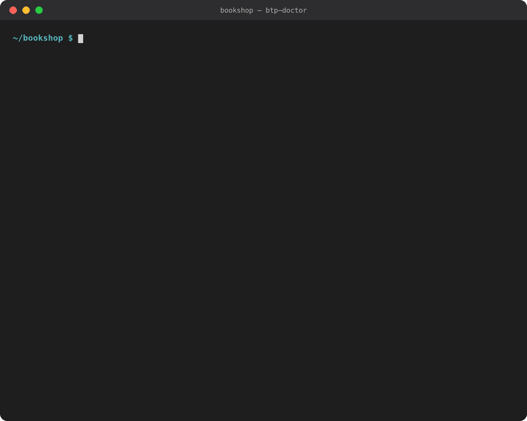

# BTP Deploy Doctor

[](https://marketplace.visualstudio.com/items?itemName=HavisunTechnologies.btp-deploy-doctor-vscode)
[](https://open-vsx.org/extension/HavisunTechnologies/btp-deploy-doctor-vscode)

Finds SAP BTP / CAP deployment mistakes **before** `cf deploy`, fixes most of them automatically, and explains failed deploy and app logs **after** it. Covers CAP services, Fiori apps in the HTML5 application repository (managed approuter, Work Zone) and multitenant SaaS apps.



| Package | What it is |
|---|---|
| [`packages/core`](packages/core) | `btp-doctor` CLI and library: project checks, log analyzer, cf log fetching |
| [`packages/vscode`](packages/vscode) | VS Code extension. Also runs in SAP Business Application Studio (BAS) |
| [`packages/mcp`](packages/mcp) | MCP server, so AI assistants such as Claude Code, Copilot and Cursor can check, fix and diagnose |

## Install

- **VS Code:** search for "BTP Deploy Doctor" in the Extensions view, or install it from the [Marketplace](https://marketplace.visualstudio.com/items?itemName=HavisunTechnologies.btp-deploy-doctor-vscode).
- **SAP Business Application Studio:** search for "BTP Deploy Doctor" in the Extensions view. BAS installs it from [Open VSX](https://open-vsx.org/extension/HavisunTechnologies/btp-deploy-doctor-vscode).

## Try it

```sh
npm install
npm run build
node packages/core/dist/cli.js check examples/broken-bookshop
node packages/core/dist/cli.js diagnose examples/broken-bookshop/deploy.log
node packages/core/dist/cli.js fix --dry-run examples/broken-bookshop
```

Examples, each with a matching failed `deploy.log`:

| Folder | What is broken |
|---|---|
| `examples/broken-bookshop` | CAP service: bindings, dependencies, auth profiles, build step |
| `examples/broken-fiori` | Fiori app: artifact names, destinations, sap.cloud.service, packaging |
| `examples/broken-saas` | Multitenant app: tenant mode, Service Manager, TENANT_HOST_PATTERN, MTX |

To try the MCP server in Claude Code, open this folder and approve the `btp-doctor` server from `.mcp.json`. Then ask, for example, "check examples/broken-fiori and fix what's safe". Setup for other clients is in [packages/mcp/README.md](packages/mcp/README.md).

## Tested on public projects

The checks run without false errors on 20 MTA projects from public SAP samples, including
SAP-samples/cap-sflight, btp-cap-multitenant-saas, btp-cap-genai-rag, fiori-tools-samples,
btp-user-management-microservice and liteinventorymanagement. Patterns from those projects
are kept as regression tests in `packages/core/src/test/real-world.test.ts`.

## Development

```sh
npm test            # build core and run its tests
npm run typecheck   # type-check the extension
npm run package -w packages/vscode   # build a .vsix to install in VS Code or BAS
```

To run the extension from source, open this folder in VS Code and press F5 (uses `.vscode/launch.json`).

### Adding a rule

- **Static check:** add it to the matching file in `packages/core/src/rules/` with a new rule ID, and a test in `src/test/check.test.ts` that breaks the clean fixture.
- **Log pattern:** add it to `packages/core/src/logs/patterns.ts` and a sample line to `src/test/logs.test.ts`. The test suite fails if a pattern has no sample.
