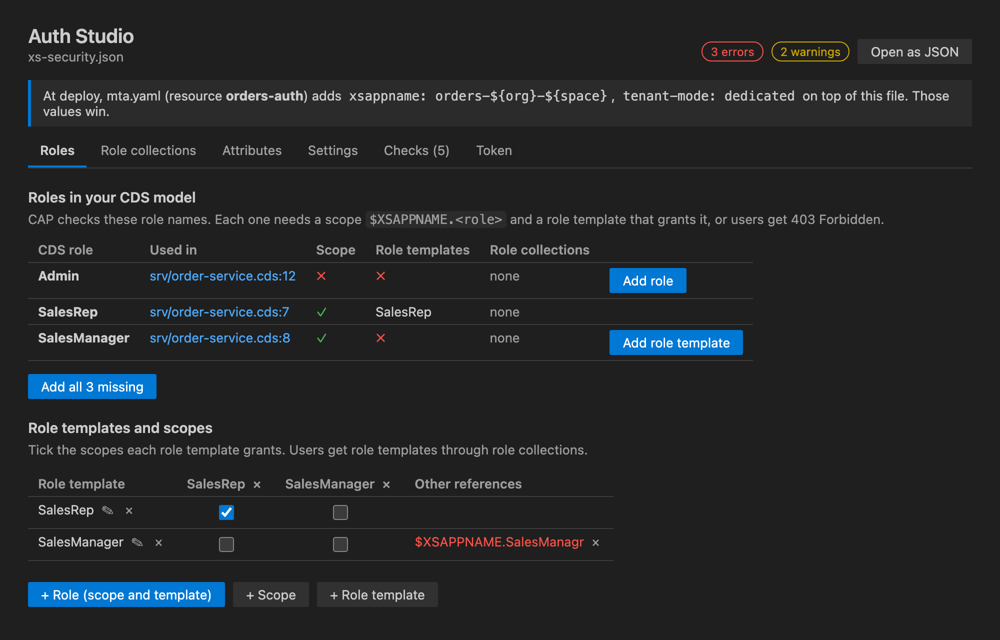
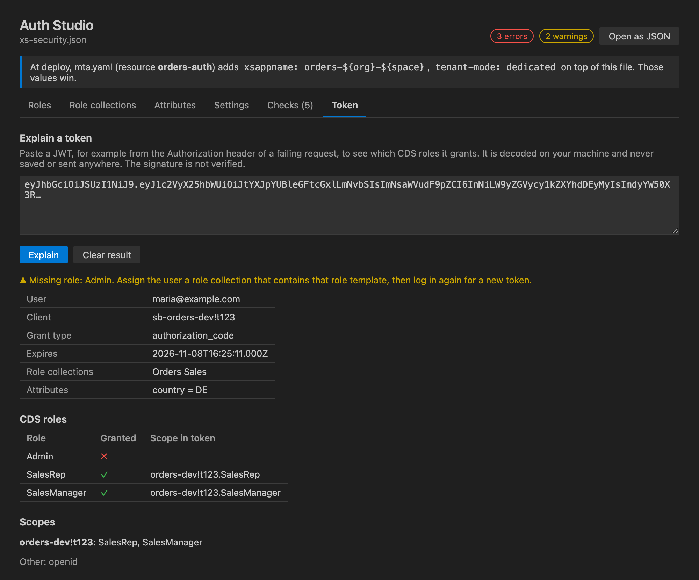

# Auth Studio for SAP BTP

A visual editor for `xs-security.json`, and a view of AMS policies for apps on Identity Authentication (IAS), both checked against your CAP model. See which roles your CDS annotations require, whether users can actually get them, and fix the gaps in a click. Paste a token to find out why a request gets 401 or 403. Works in VS Code and SAP Business Application Studio (BAS).

[Product page](https://www.havisun.com/tools/auth-studio/) · [Guide: Why your SAP CAP app returns 403 after deploy](https://www.havisun.com/insights/sap-cap-403-forbidden-after-deploy.html)

> **Preview.** Please [report problems or ideas](https://github.com/havisun-tech/btp-deploy-doctor/issues/new/choose).

## Open it

Open an `xs-security.json` and click **Open in Auth Studio** (the shield in the editor title bar), or right-click the file in the Explorer. **Open as JSON** switches back. Both views edit the same document, so Undo, Save and Git work as usual, and your formatting is kept.

No `xs-security.json` yet? Run **Auth Studio: Create xs-security.json from CDS Model**. It creates a scope and role template for every role in your `@requires` and `@restrict` annotations, and the attributes your `where` conditions read.

## What you can do

- **Roles:** every role your CDS model checks, where it is used, and whether it has a scope, a role template and a role collection. Add what is missing one at a time or all at once. Tick which scopes each role template grants.
- **Role collections:** tick which role templates each collection contains.
- **Attributes:** the `$user` attributes your `@restrict` conditions read, and which role templates pass them on.
- **Settings:** xsappname, tenant mode and allowed redirect URIs. Values that `mta.yaml` overrides at deploy are shown next to them.
- **Checks:** problems in the file as you type (unknown references, duplicate names, names XSUAA rejects), and the project checks from [Deploy Doctor for SAP BTP](https://marketplace.visualstudio.com/items?itemName=HavisunTechnologies.btp-deploy-doctor-vscode): the approuter bound to XSUAA, tokens forwarded to your service, and more, with one-click fixes.
- **Token:** paste a JWT from a failing request to see the user, scopes, role collections, attributes and expiry, and which of your CDS roles it grants. It tells you when the token comes from a different XSUAA instance, has expired or is a technical token.

## AMS policies (IAS)

CAP apps that log in with Identity Authentication give roles through Authorization Management Service (AMS) policies, written in `.dcl` files under `ams/dcl`, instead of xs-security.json. Open any `.dcl` file and click the shield, or run **Auth Studio: Open AMS Policies**.

- **Roles:** every role your CDS model checks, and the policies that give it, directly (`ASSIGN ROLE`) or by building on another policy (`USE`), with their conditions. A role no policy gives fails every request with 403; **Add policy** adds it to `basePolicies.dcl`. That matters because `cds build` does not regenerate a DCL file that already exists, so roles added to the model later are easy to miss.
- **Policies:** all policies by package, with the roles they assign, the policies they use and their restrictions. Unknown roles and policies are marked.
- **Attributes:** the attributes in `schema.dcl`, the CDS elements `@ams.attributes` maps them to, and the policies that use them.
- **Checks:** a role no policy gives, a policy assigning a role the model does not use (often a typo), `USE` of a policy that does not exist, duplicate policies, attributes missing from the schema, `@sap/ams` only a dev dependency, and no module in mta.yaml that deploys the policies. Most have a one-click fix.
- **Token:** paste an IAS token to see the user, tenant and expiry. IAS tokens do not carry roles, so it lists, for each CDS role, the policies to assign the user in the Identity Authentication admin console. It also explains API permission groups (`ias_apis`) and catches XSUAA tokens sent to an IAS app.

`.dcl` files also get syntax highlighting.

## mta.yaml is taken into account

If the XSUAA resource in `mta.yaml` sets `parameters.config` (for example `xsappname: myapp-${space}` or role collections), XSUAA receives your file with those values on top. Auth Studio shows a banner with what is overridden, and judges roles and problems on the combined result.

## Updating the running instance

Changes reach XSUAA only when you redeploy, or update the service instance. **Settings > Prepare cf update-service** opens a terminal with `cf update-service <instance> -c xs-security.json` filled in, without running it. When `mta.yaml` adds config to the file, it tells you to redeploy instead, because updating with the file alone would drop those values.

## Privacy

Everything runs locally. The extension sends no telemetry and makes no network requests. Tokens are decoded on your machine, are never stored or sent anywhere, and their signature is not verified.

## Not covered yet

Writing `@requires` and `@restrict` annotations into your `.cds` files (Auth Studio links to the line instead), editing AMS policies in a form (they stay text, with checks and links), assigning role collections or policies to users, and CAP Java projects.

## More free tools for SAP BTP

- [Deploy Doctor for SAP BTP](https://marketplace.visualstudio.com/items?itemName=HavisunTechnologies.btp-deploy-doctor-vscode): catches deployment mistakes before `cf deploy` and explains failed deploy logs.
- [Connectivity Doctor for SAP BTP](https://marketplace.visualstudio.com/items?itemName=HavisunTechnologies.connectivity-doctor-vscode): checks a deployed app's destinations, OAuth tokens and Cloud Connector setup.

All on [havisun.com/tools](https://www.havisun.com/tools/).

Made by [HAVISUN Technologies](https://www.havisun.com). Licensed under Apache 2.0.

Not affiliated with or endorsed by SAP SE. SAP, SAP BTP, SAP Business Application Studio and SAP Fiori are trademarks or registered trademarks of SAP SE in Germany and other countries.
