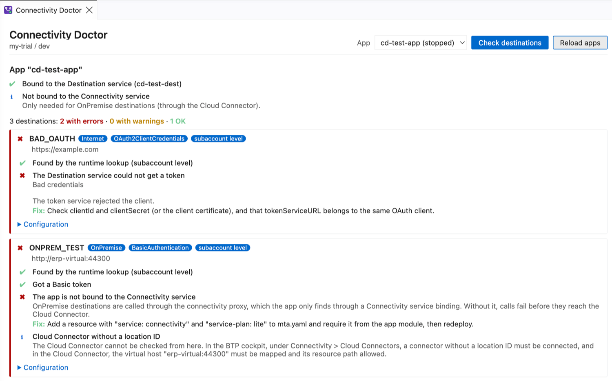
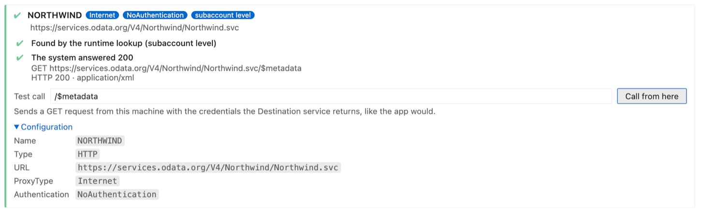

# Connectivity Doctor for SAP BTP

Finds out why a deployed SAP BTP app cannot reach another system. It checks every destination the app can use, the same way the app looks them up at runtime, and explains each problem with a fix: missing or misspelled destinations, OAuth tokens the Destination service cannot get, OnPremise destinations without a Connectivity binding, Cloud Connector settings to check, and the answer of a test call. Works in VS Code and SAP Business Application Studio (BAS).

[Product page and guides on havisun.com](https://www.havisun.com/tools/) · [Deploy Doctor](https://marketplace.visualstudio.com/items?itemName=HavisunTechnologies.btp-deploy-doctor-vscode) · [Auth Studio](https://marketplace.visualstudio.com/items?itemName=HavisunTechnologies.auth-studio-vscode)



> **Preview.** Please [report problems or ideas](https://github.com/havisun-tech/btp-deploy-doctor/issues/new/choose).

## Use it

1. Log in to Cloud Foundry: `cf login` in a terminal, or **CF: Login to Cloud Foundry** in BAS.
2. Run **Connectivity Doctor: Check Destinations of a Deployed App** from the Command Palette, or right-click `mta.yaml`.
3. Pick the app that calls other systems, usually the CAP service, and click **Check destinations**.

## What it checks

**Bindings**
- The app is bound to the Destination service, and its credentials work.
- OnPremise destinations have a Connectivity service binding.
- User-dependent authentication has an XSUAA or IAS binding to take the user from.

**Each destination**
- It is found by the runtime lookup (service instance level first, then subaccount).
- Destinations your CAP project uses in `cds.requires.<service>.credentials.destination` exist. Names must match exactly, so it points out names that differ in case or are similar.
- The Destination service gets the token: OAuth2ClientCredentials, OAuth2Password, BasicAuthentication and others. Errors such as `invalid_client` or an unknown token host are explained.
- Configuration: URL, ProxyType, the properties each authentication type needs, key store certificates that exist, `https://` on OnPremise destinations, internal hosts on Internet destinations.
- OnPremise: the Cloud Connector location ID and virtual host to check, and how principal propagation works.

**Test it**
- **Call from here** sends a GET request to an Internet destination with the credentials the Destination service returns, optionally to a path such as `.../$metadata`, and explains the answer (401, 403, 404, redirects to a login page, TLS and DNS errors).
- **Test the token exchange** for OAuth2UserTokenExchange, OAuth2JWTBearer and OAuth2SAMLBearerAssertion with a user token you paste.



**Copy report as text** gives a report without secrets or tokens, for a ticket or a colleague.

## What it does not do

- OnPremise systems cannot be called from your machine or BAS. They are only reachable from inside Cloud Foundry through the connectivity proxy. Connectivity Doctor checks everything up to the Cloud Connector and tells you what to check there.
- In multitenant apps, subscriber requests use destinations in the subscriber's subaccount, which it cannot see.
- Only HTTP destinations are checked. RFC, MAIL and LDAP destinations are listed but not tested.

## Privacy and security

- It uses your own `cf` login to read the app's service bindings (`cf curl /v3/apps/<guid>/env`, which needs the Space Developer role).
- With the app's Destination service credentials, it calls the Destination service of your subaccount. Credentials, tokens and pasted user tokens stay in memory and are never stored or shown. Passwords and secrets in destination configurations are masked.
- A target system is only called when you click **Call from here**.
- No telemetry.

## Command line

The same check runs in a terminal or pipeline, with the `btp-doctor` CLI from the [repository](https://github.com/havisun-tech/btp-deploy-doctor):

```sh
btp-doctor connectivity --app orders-srv            # check all destinations
btp-doctor connectivity --app orders-srv --test-call   # also call Internet destinations
```

It exits with code 1 when it finds errors.

## Settings

- `connectivityDoctor.cfPath`: path to the Cloud Foundry CLI (default `cf`).

---

Made by [HAVISUN Technologies](https://www.havisun.com). Licensed under Apache 2.0.

Not affiliated with or endorsed by SAP SE. SAP, SAP BTP, SAP Business Application Studio and SAP S/4HANA are trademarks or registered trademarks of SAP SE in Germany and other countries.
